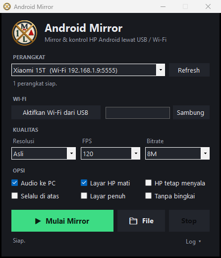
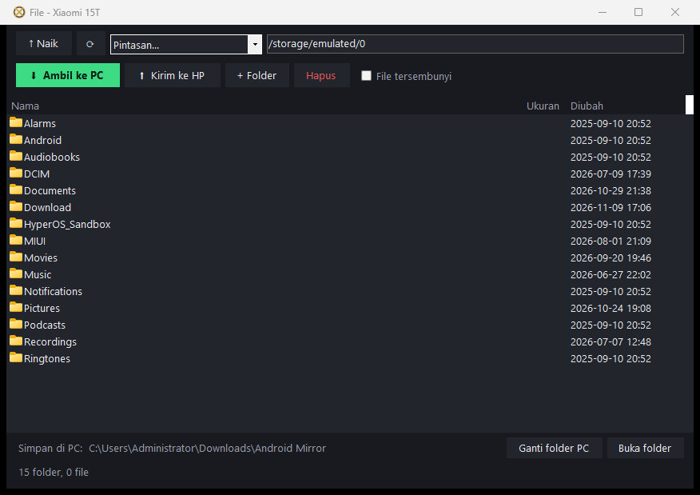

<p align="center">
  
</p>

<h1 align="center">Android Mirror</h1>

<p align="center">
  <b>Tampilkan, kontrol, dan transfer file HP Android langsung dari PC Windows.</b><br>
  Lewat kabel USB atau Wi-Fi, tanpa root, tanpa install aplikasi apa pun di HP.
</p>

<p align="center">
  <a href="https://github.com/malik-jpg/android-mirror/releases/latest"><b>⬇ Download installer (Windows 10/11, 64-bit)</b></a>
</p>

<p align="center">
  
  &nbsp;
  
</p>

---

## ✨ Fitur

| | Fitur | Keterangan |
| :-: | :--- | :--- |
| 📺 | **Mirror layar real-time** | Sampai 120 fps, resolusi asli HP, latensi rendah (decoding hardware di PC). |
| 🖱️ | **Kontrol penuh pakai mouse & keyboard** | Klik = sentuh, drag = swipe, scroll mouse/touchpad = scroll, Ctrl+drag = pinch zoom, ketik langsung dari keyboard PC. |
| 🔊 | **Audio HP keluar di PC** | Suara game, video, musik ikut ke speaker/headset PC (Android 11+). |
| 📶 | **USB atau Wi-Fi** | Satu klik "Aktifkan Wi-Fi dari USB", lalu kabel boleh dicabut. |
| 📁 | **Transfer file dua arah** | Jelajahi isi HP, ambil foto/video/dokumen ke PC, kirim file ke HP (drag & drop), buat folder, ganti nama, hapus. |
| ⚡ | **Pintasan folder** | Kamera, Screenshot, Download, Dokumen, Video, Musik, WhatsApp Media, Telegram. |
| 📋 | **Clipboard tersinkron** | Copy di HP → paste di PC, dan sebaliknya. |
| 🌑 | **Layar HP mati saat mirror** | Hemat baterai & privasi, tampilan di PC tetap menyala. |
| 📌 | **Selalu di atas / Layar penuh / Tanpa bingkai** | Cocok untuk presentasi, streaming, atau main game. |
| 📦 | **Drag & drop APK** | Seret file .apk ke jendela mirror → langsung terinstal di HP. |
| 🪶 | **Ringan** | Aplikasi ±200 KB, RAM ±45 MB. Pengaturan terakhir otomatis diingat. |

---

## 🚀 Cara Pakai

### 1. Install di PC
1. Download **`AndroidMirror-Setup-x.x.x.exe`** dari halaman [Releases](https://github.com/malik-jpg/android-mirror/releases/latest).
2. Jalankan installer → **Next** sampai selesai. Tidak butuh hak admin.
   > Kalau muncul *"Windows protected your PC"*, klik **More info → Run anyway**. Ini normal untuk aplikasi gratis tanpa sertifikat berbayar.
3. Buka **Android Mirror** dari Desktop atau Start Menu.

### 2. Siapkan HP (cukup sekali)
1. **Settings → About phone** → ketuk **Build number** 7 kali sampai muncul *"You are now a developer"*.
2. **Settings → (System / Additional settings) → Developer options** → nyalakan **USB debugging**.
3. Colok HP ke PC pakai kabel data → di HP ketuk **Allow / Izinkan** (centang *Always allow*).

> **Xiaomi / Redmi / POCO (MIUI / HyperOS):** nyalakan juga **USB debugging (Security settings)** di Developer options, lalu restart HP. Tanpa ini gambar tampil tapi sentuhan/scroll tidak jalan. Opsi ini butuh login Mi Account, dan sering butuh SIM + data seluler aktif saat menyalakannya.
>
> **OPPO / realme / vivo:** nyalakan **Disable permission monitoring** bila sentuhan tidak jalan.

### 3. Mulai mirror
1. HP akan muncul di kolom **Perangkat** (misal `Xiaomi 15T (USB ...)`).
2. Atur **Kualitas** bila perlu (makin kecil resolusi/bitrate = makin ringan).
3. Klik **▶ Mulai Mirror**. Tutup jendela mirror atau klik **Stop** untuk berhenti.

### 4. Pakai Wi-Fi (opsional)
1. Pastikan HP & PC di jaringan Wi-Fi yang sama.
2. Colok USB → klik **Aktifkan Wi-Fi dari USB** → tunggu status *"Wi-Fi tersambung"*.
3. Cabut kabel. Lain kali cukup klik **Sambung** (IP sudah tersimpan).

### 5. Transfer file
1. Klik **📁 File** (atau buka shortcut **Android Mirror - File**).
2. **HP → PC:** pilih file/folder (Ctrl+klik untuk banyak) → **⬇ Ambil ke PC**. Double-click file = ambil & langsung buka.
   File tersimpan di `Downloads\Android Mirror` (bisa diganti lewat **Ganti folder PC**).
3. **PC → HP:** seret file dari Explorer ke daftar, atau klik **⬆ Kirim ke HP**. File masuk ke folder yang sedang dibuka.
4. Klik kanan untuk **Ganti nama** / **Hapus**. Tombol cepat: `Backspace` naik folder, `F5` refresh, `F2` ganti nama, `Del` hapus, `Ctrl+A` pilih semua.

---

## ⌨️ Kontrol di Jendela Mirror

| Di PC | Di HP |
| :--- | :--- |
| Klik kiri | Tap |
| Klik kiri + geser | Swipe / drag |
| Scroll mouse / 2 jari touchpad | Scroll |
| Ctrl + klik + geser | Pinch zoom / putar |
| Klik kanan | Back |
| Klik tengah | Home |
| Ketik di keyboard | Mengetik di HP |
| Drag & drop file | Kirim ke `Download` HP (.apk = install) |
| `Alt+F` | Layar penuh |
| `Alt+H` / `Alt+B` / `Alt+S` | Home / Back / Recent apps |
| `Alt+O` / `Alt+Shift+O` | Matikan / nyalakan layar HP |
| `Alt+↑` / `Alt+↓` | Volume naik / turun |
| `Alt+R` | Putar layar |
| `Alt+N` | Buka panel notifikasi |

---

## ❓ Masalah Umum

| Masalah | Solusi |
| :--- | :--- |
| HP tidak muncul di daftar | Cek USB debugging menyala, ganti kabel (harus kabel data), klik **Refresh**. |
| Muncul "izinkan USB debugging di HP" | Buka layar HP, ketuk **Allow**. |
| Gambar tampil tapi tidak bisa disentuh | Xiaomi: nyalakan **USB debugging (Security settings)** lalu restart HP. |
| Tidak ada suara | Butuh Android 11+. Centang **Audio ke PC**. |
| Patah-patah lewat Wi-Fi | Turunkan Resolusi ke 1280 & Bitrate ke 4M, atau pakai USB. |
| Detail error | Klik **Log ▾** di jendela utama. |

---

## 🛠️ Build dari Source

Tidak perlu Visual Studio. Cukup Windows 10/11 + [scrcpy](https://github.com/Genymobile/scrcpy) + (untuk installer) [Inno Setup 6](https://jrsoftware.org/isinfo.php):

```powershell
winget install Genymobile.scrcpy
winget install JRSoftware.InnoSetup
.\build.ps1 -Installer
```

Hasil: `dist\app\Android Mirror.exe` dan `dist\AndroidMirror-Setup-<versi>.exe`.
Kode sumber ada di `src\` (C# WinForms, .NET Framework 4 bawaan Windows).

---

## 🙏 Kredit & Lisensi

- Mirror & kontrol memakai **[scrcpy](https://github.com/Genymobile/scrcpy)** oleh Genymobile & Romain Vimont (Apache-2.0), dibundel di dalam installer. Android Mirror adalah tampilan (front-end) independen, tidak berafiliasi dengan Genymobile.
- Android Mirror © 2026 MalixNet, dirilis dengan lisensi [MIT](LICENSE).
